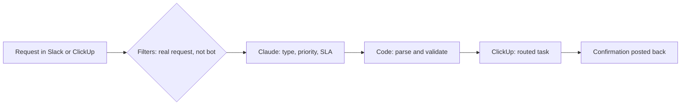
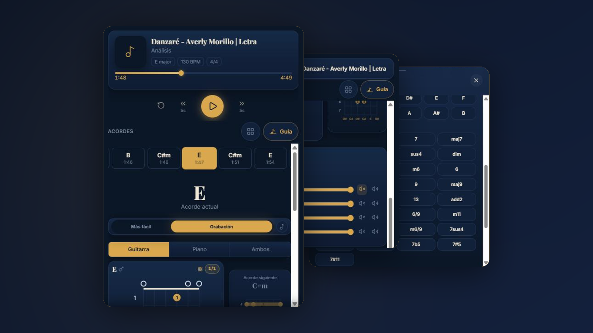
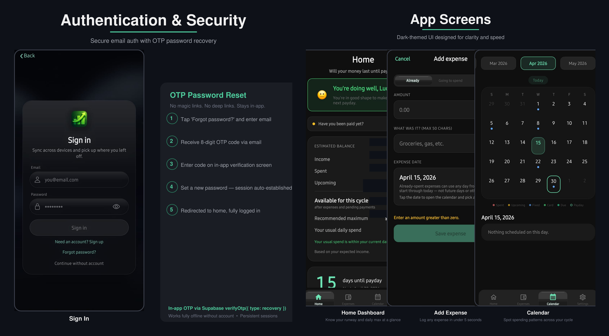

# Hey, I'm Ludwing

Technology Engineer at Patient Engine and independent developer from El Salvador.

I build the automation layer companies run on: AI classification, integrations, and workflows built on top of the tools teams already use, so they don't spend months adapting to something new. On my own time I design and ship web apps, mobile apps, and AI workers for clients.

## What I do now

**At Patient Engine** (healthcare marketing SaaS for med spas) I designed a company-wide tech request system (custom Slack app, Claude AI classification against the SLA rulebook, routed ClickUp tasks, automatic confirmations), marketing ops data syncs, A2P 10DLC compliance automation, and leadership dashboards.

Real flowcharts and case studies: **[business automation portfolio](https://github.com/LudwingPV/automation-integration-portfolio)**

**Before that, at Thoughtful AI (Smarter Technologies)**, I designed, deployed, and optimized AI workers that automated healthcare revenue cycle operations end to end: eligibility verification, claims processing, denial management, payment posting, and prior authorization across Medicare, Medicaid, and commercial payers, resolving up to 70% of RCM tasks.

## Where I've been

**Patient Engine** (2026 - Present): Technology Engineer. Business automation, AI classification pipelines, custom Slack apps, ClickUp, GoHighLevel, Twilio, Zapier, Claude.

**Thoughtful AI** (2024 - 2026): Customer Success Engineer bridging customers and engineering. End-to-end delivery and optimization of AI/RPA automation for US healthcare revenue cycles. Python, Robocorp, Selenium, OpenAI and Anthropic SDKs, OCR, API integrations, Jira.

**Dataprise, National Spine and Center** (2023 - 2024): IT Engineer II. Azure cloud security (Private Link, NSGs, Defender for Cloud), vulnerability management (Nessus, Splunk), Active Directory, Microsoft 365, Mimecast, endpoint management.

**Blackhawk Network** (2019 - 2023): Risk Analytics Analyst. Fraud pattern detection, Power BI dashboards for regulatory compliance and business performance.

**Telus El Salvador / Google** (2017 - 2019): Sales Development Technology. Enterprise retail client relationships, C-level presentations, Salesforce, Google Console sys-admin.

## Tech

**AI & Automation:** Claude (Anthropic), OpenAI / GPT, Gemini, Claude Code, Cursor, MCP servers, prompt engineering, AI workers, agentic workflows, RPA, OCR, Zapier, n8n

**Business Systems:** ClickUp, Slack apps (slash commands, shortcuts, Events API), GoHighLevel, Twilio, HubSpot, Salesforce, Google Sheets

**Mobile & Frontend:** React Native, Expo, TypeScript, Expo Router, EAS Build/Submit, HTML, CSS, JavaScript

**Backend & Data:** Supabase (Auth, Database, Edge Functions, Realtime), PostgreSQL, Python, Node.js, Deno, REST APIs

**Cloud & Infra:** Microsoft Azure, Vercel, Railway, Modal, Active Directory, Microsoft 365, Okta SSO, VMware, Hyper-V, PowerShell

**Security:** Nessus, Splunk, IBM QRadar, ELK/SIEM, Microsoft Defender, Kali Linux, Metasploit, Nmap, Wireshark, Snort, Fortinet

**Dev Tools:** Git, GitHub Actions, Vitest, VS Code, Power BI, Jira, ServiceNow, Figma

## Certifications

Google Project Management Professional (2025) | CISSP (ISC)2 (In Progress) | Digital Forensics DFMC+ (2024) | Ethical Hacking Zero to Hero (2024) | Mastering Windows Security (2024) | Google Data Analytics Professional (2024) | Microsoft Cybersecurity Analyst Professional (2024) | IBM Cybersecurity Fundamentals (2024) | Google Cybersecurity Professional (2023-2024) | Google IT Support Professional (2023)

## Projects

### ChordSight: Chord Analysis for Musicians

Web app that detects the chords of a song, plays them in sync with guitar diagrams, and separates the audio into stems so musicians can practice each part. Built for a music team that reviews and corrects chords; their corrections feed the training data for automatic detection.

- Synced chord player with guitar diagrams, transposition, and capo
- Stem separation with a per-track mixer (volume, solo, mute)
- Chord editor with root and quality selector, including add2 and add9 voicings
- Admin review workflow: suggestions, full-song review, and a correction log

**Tech:** TypeScript, Supabase (PostgreSQL), Railway (API and worker), Modal, Vercel

**Status:** In production, live at **[chordsight.vercel.app](https://chordsight.vercel.app)**

  

### CashFlow: Mobile Finance App

Built for salaried workers in El Salvador to manage money between paydays. Solo build, end to end: product, frontend, backend, and logic automation.

**Tech:** React Native, Expo, TypeScript, Supabase

  

## Connect

